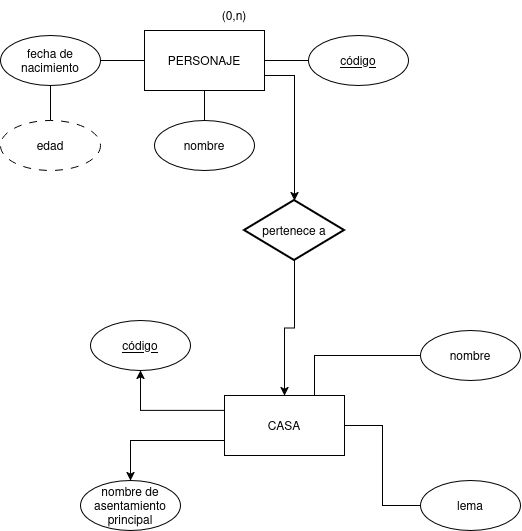
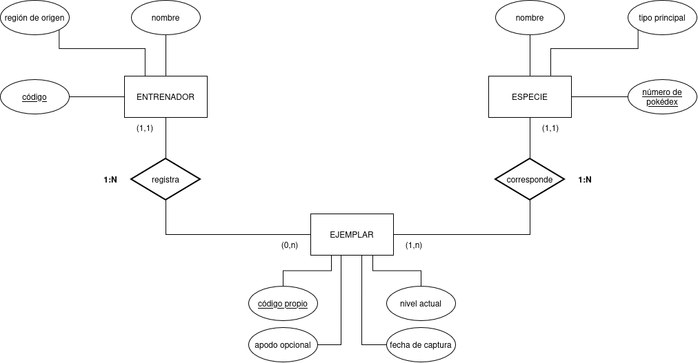
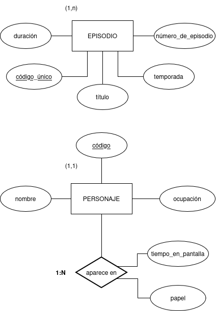
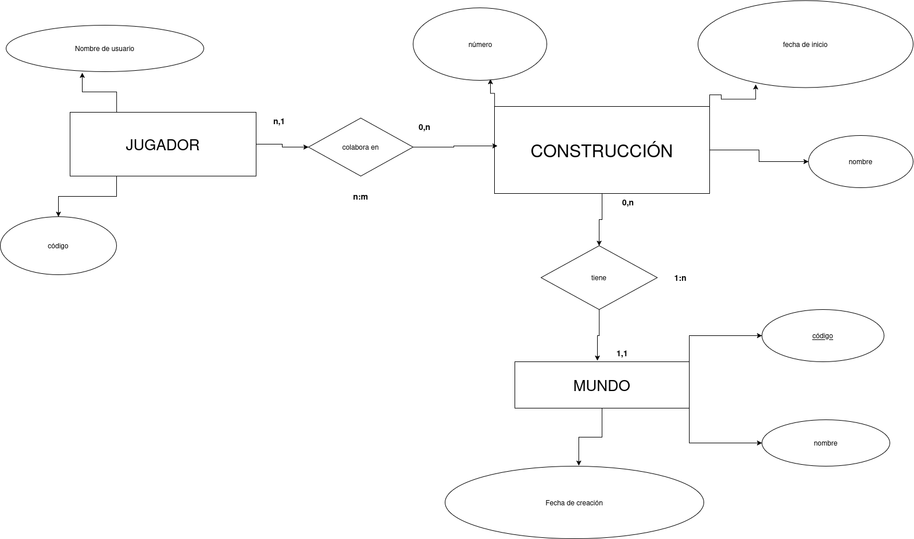
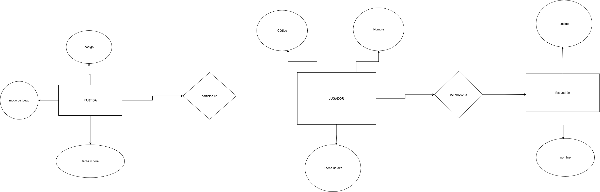
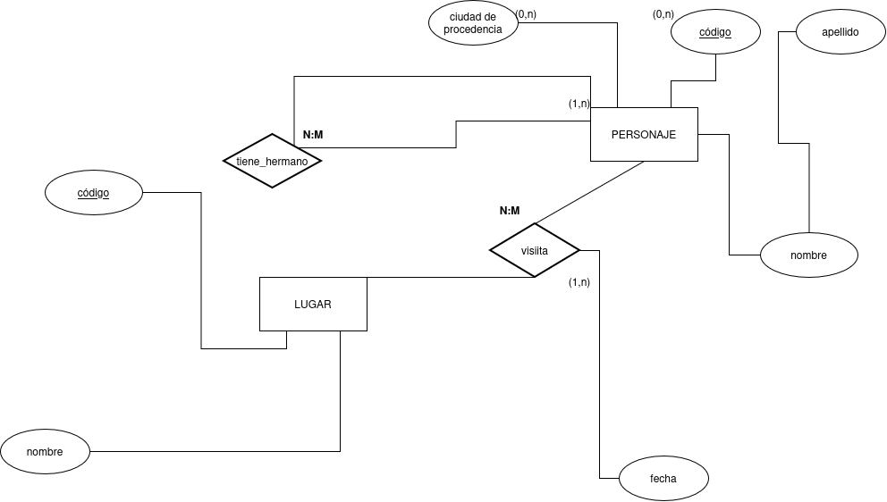
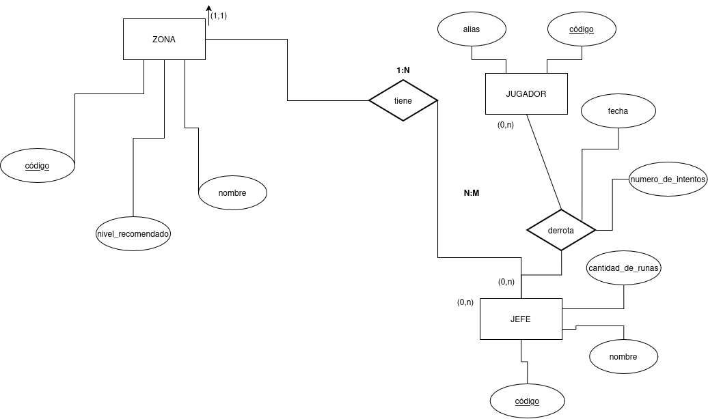

# ACTIVIDAD 1 MODELOS E/R

## EJERCICIO 1

### *ENTIDADES Y ATRIBUTOS*

**PERSONAJE** *Código, nombre, fecha de nacimiento, título nobiliario*

**CASA:**  *Código, nombre, lema, nombre del asentamiento principal*

## EJERCICIO 2

### *ENTIDADES Y ATRIBUTOS*

**ENTRENADOR** *<u>Código</u>, nombre, región de origen*

**EJEMPLAR** *<u>código propio</u> , nivel actual, mote (opcional), fecha de captura*

**ESPECIE** *Nombre, tipo principal, número de pokedex*

## EJERCICIO 3

### *ENTIDADES Y ATRIBUTOS*

**PERSONAJE** *<u>Código</u>, nombre, ocupación*

**EPISODIO** *<u>Código</u>, título, temporada, número de episodio, duracion en min*

## EJERCICIO 4

### *ENTIDADES Y ATRIBUTOS*

**MUNDO** *<u>Código</u>, nombre, fecha de creación*

**CONSTRUCCIONES** *nombre, fecha de inicio, número*

**JUGADOR** *Nombre de usuario, código*

 

## EJERCICIO 5

### *ENTIDADES Y ATRIBUTOS*

**JUGADOR** *<u>código</u>, nombre de usuario, fecha de alta*

**ESCUADRÓN** *<u>código</u>, nombre

**PARTIDAS** *<u>código</u>, fecha, hora, modo de juego*

**PARTICIPACIÓN EN PARTIDA** *Posición, eliminaciones*

## EJERCICIO 6

### *ENTIDADES Y ATRIBUTOS*

**PERSONAJES** *<u>Código</u>, ciudad de procedencia, nombre >apellido*

**PARENTESCO**

**LUGAR** *<u>Código</u>, nombre*

## EJERCICIO 7

### *ENTIDADES Y ATRIBUTOS*

**ZONA** *C<u>Código</u>, nombre, nivel recomendado*

**JEFE** *C<u>Código</u>, nombre, cantidad de runas primera vez*

**JUGADOR** *<u>Código</u>, alias**

## EJERCICIO 8

### *ENTIDADES Y ATRIBUTOS* 

**JUGADOR** *<u>Código</u>, nombre de usuario*

**AGENTES** *<u>Código</u>, nombre, rol*

**PARTIDA** *<u>Código</u>, fecha, mapa*

