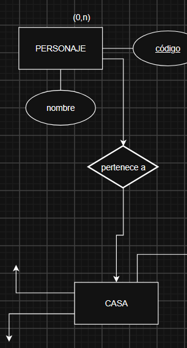
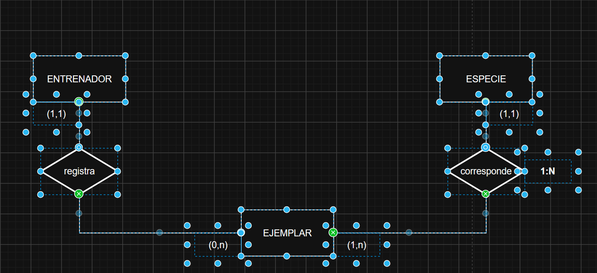
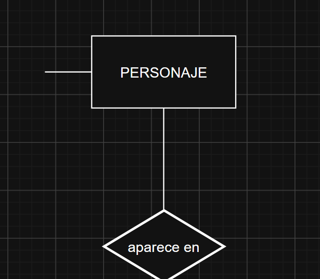
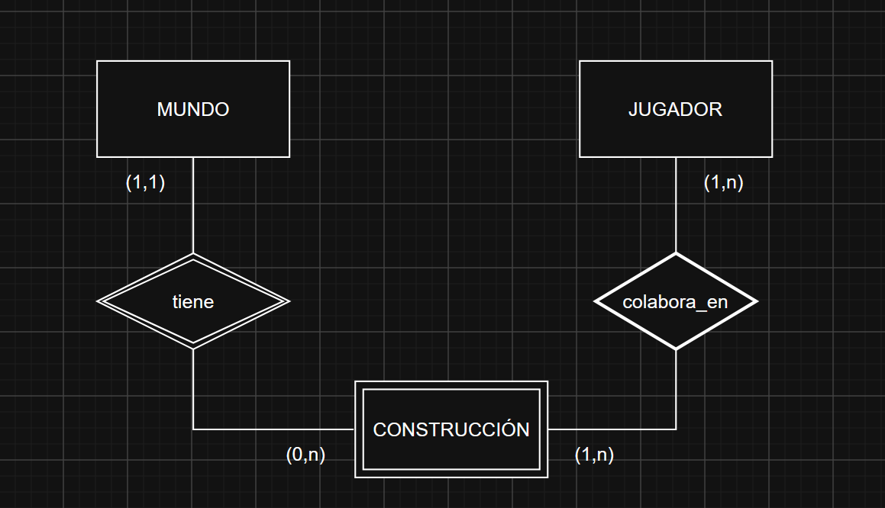
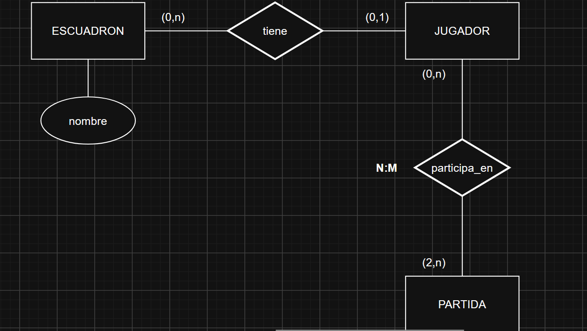
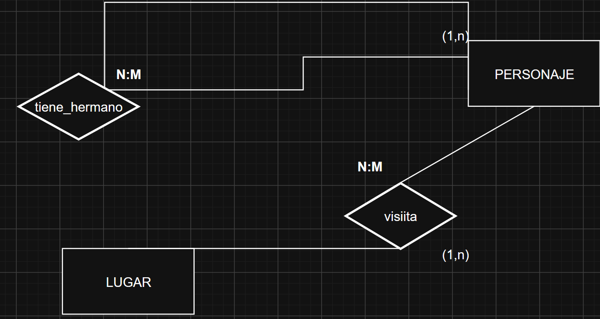
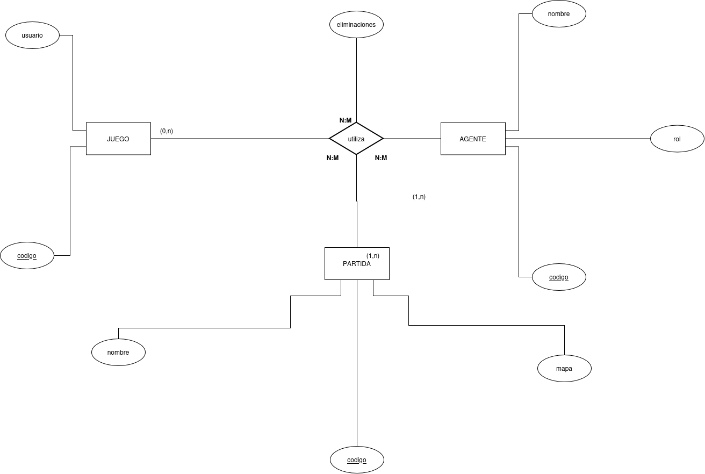
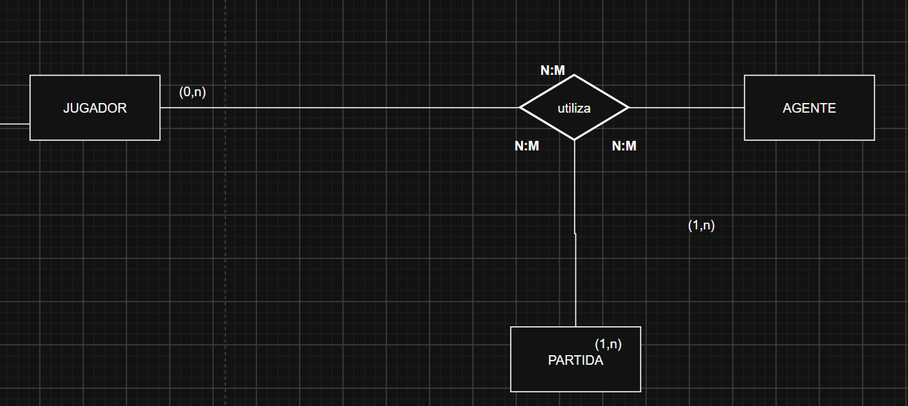
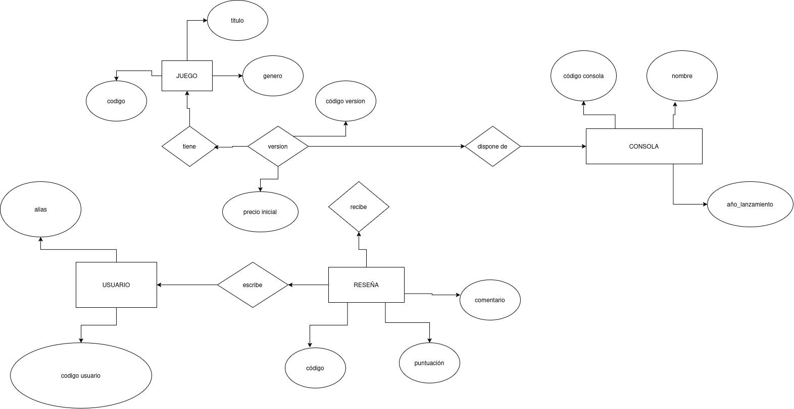
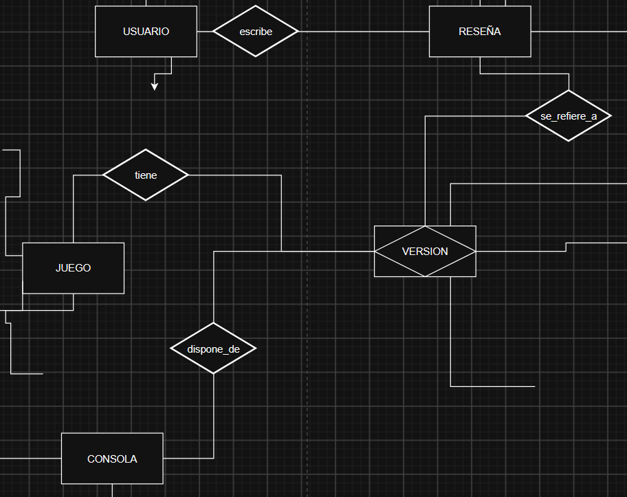

# ACTIVIDAD 1 MODELOS E/R

## EJERCICIO 1

### *ENTIDADES Y ATRIBUTOS*

**PERSONAJE:** *Código, nombre, fecha de nacimiento, título nobiliario*

**CASA:**  *Código, nombre, lema, nombre del asentamiento principal*

RELACIONES Y CARDINALIDADES

PERTENECE (PERSONAJE – CASA)

Junto a	Cardinalidad	Lectura
CASA	(1,1)	Un personaje pertenece a una y solo una casa

PERSONAJE	(0,N)	Una casa puede tener cualquier número de personajes, incluso ninguno

## EJERCICIO 2

### *ENTIDADES Y ATRIBUTOS*

**ENTRENADOR:** *<u>Código</u>, nombre, región de origen*

**EJEMPLAR:** *<u>código propio</u> , nivel actual, mote (opcional), fecha de captura*

**ESPECIE:** *Nombre, tipo principal, número de pokedex*

RELACIONES Y CARDINALIDADES

CAPTURA (ENTRENADOR – EJEMPLAR)

Junto a	Cardinalidad	Lectura

ENTRENADOR	(1,1)	Un ejemplar pertenece a un único entrenador

EJEMPLAR	(0,N)	Un entrenador puede tener varios ejemplares (supuesto: puede no tener ninguno)

## EJERCICIO 3

### *ENTIDADES Y ATRIBUTOS*

**PERSONAJE:** *<u>Código</u>, nombre, ocupación*

**EPISODIO:** *<u>Código</u>, título, temporada, número de episodio, duracion en min*

RELACIONES Y CARDINALIDADES

APARECE (PERSONAJE – EPISODIO)

Atributos de la relación: tiempo en pantalla (aproximado), papel (principal/secundario)

Junto a	Cardinalidad	Lectura
PERSONAJE	(1,N)	Un episodio incluye al menos un personaje
EPISODIO	(0,N)	Un personaje puede aparecer en muchos episodios o en ninguno todavía

## EJERCICIO 4

### *ENTIDADES Y ATRIBUTOS*

**MUNDO:** *<u>Código</u>, nombre, fecha de creación*

**CONSTRUCCIONES:** *nombre, fecha de inicio, número*

**JUGADOR:** *Nombre de usuario, código*

 

COLABORA (JUGADOR – CONSTRUCCIÓN)

Atributo de la relación: fecha de inicio de la colaboración

Junto a	Cardinalidad	Lectura

JUGADOR	(0,N)	Una construcción puede no tener colaboradores o tener varios

CONSTRUCCIÓN	(0,N)	Un jugador puede colaborar en varias construcciones (supuesto: o en ninguna)

## EJERCICIO 5

### *ENTIDADES Y ATRIBUTOS*

**JUGADOR:** *<u>código</u>, nombre de usuario, fecha de alta*

**ESCUADRÓN:** *<u>código</u>, nombre

**PARTIDAS:** *<u>código</u>, fecha, hora, modo de juego*

**PARTICIPACIÓN EN PARTIDA:** *Posición, eliminaciones*

PARTICIPA (JUGADOR – PARTIDA)

Atributos de la relación: posición final, número de eliminaciones

Junto a	Cardinalidad	Lectura

JUGADOR	(2,N)	Cada partida registrada tiene al menos dos jugadores

PARTIDA	(0,N)	Un jugador puede participar en muchas partidas o en ninguna aún

## EJERCICIO 6

### *ENTIDADES Y ATRIBUTOS*

**PERSONAJES:** *<u>Código</u>, ciudad de procedencia, nombre >apellido*

**PARENTESCO:**

**LUGAR:** *<u>Código</u>, nombre*

RELACIONES Y CARDINALIDADES

ES_HERMANO_DE (PERSONAJE – PERSONAJE) (relación reflexiva, con roles «hermano 1» y «hermano 2»)

Junto a	Cardinalidad	Lectura

PERSONAJE	(0,N)	Un personaje puede no tener hermanos registrados o varios

PERSONAJE	(0,N)	(mismo razonamiento desde el otro rol)

VISITA (PERSONAJE – LUGAR)

Atributo de la relación: fecha (en la cronología de la enciclopedia)

Junto a	Cardinalidad	Lectura

LUGAR	(0,N)	Un personaje puede visitar varios lugares

PERSONAJE	(0,N)	Un lugar puede ser visitado por varios personajes

## EJERCICIO 7

### *ENTIDADES Y ATRIBUTOS*

**ZONA:** *<u>Código</u>, nombre, nivel recomendado*

**JEFE:** *<u>Código</u>, nombre, cantidad de runas primera vez*

**JUGADOR:** *<u>Código</u>, alias**

RELACIONES Y CARDINALIDADES

APARECE_EN (JEFE – ZONA)

Junto a	Cardinalidad	Lectura

ZONA	(1,1)	Cada jefe aparece en una sola zona

JEFE	(0,N)	Una zona puede tener varios jefes o ninguno

DERROTA (JUGADOR – JEFE)

Atributos de la relación: fecha de la primera victoria, número de intentos

Junto a	Cardinalidad	Lectura

JUGADOR	(0,N)	Un jefe puede ser derrotado por muchos jugadores o por ninguno

JEFE	(0,N)	Un jugador puede derrotar a muchos jefes o a ninguno

[Zona_tien_jefe_jugador_derrota_jefe](IMG/zona_tiene_jefe_que_jugador_derrota.png)

## EJERCICIO 8

### *ENTIDADES Y ATRIBUTOS* 

**JUGADOR:** *<u>Código</u>, nombre de usuario*

**AGENTES:** *<u>Código</u>, nombre, rol*

**PARTIDA:** *<u>Código</u>, fecha, mapa*

RELACIONES Y CARDINALIDADES

JUEGA (JUGADOR – AGENTE – PARTIDA) (relación ternaria)

Atributo de la relación: eliminaciones

Entidad	Participación	Lectura

JUGADOR	(0,N)	Un jugador registrado puede no haber jugado ninguna partida o jugar muchas

AGENTE	(0,N)	Un agente puede no haber intervenido o ser usado en muchas partidas

PARTIDA	(1,N)	Una partida debe contar con al menos un jugador

## EJERCICIO 9

### *ENTIDADES Y ATRIBUTOS*

**JUEGO** *<u>Código</u>, título y género*

**CONSOLA** *<u>Código</u>, nombre, fecha de lanzamiento*

**VERSIÓN** *<u>Código</u>, fecha de lanzamiento, precio inicial*

**USUARIO** *<u>Código</u>, alias*

**RESEÑAS** *<u>Código propio</u>, puntuación, usuario, comentario*

RELACIONES Y CARDINALIDADES

TIENE_VERSIÓN (JUEGO – VERSIÓN)

Junto a	Cardinalidad	Lectura

JUEGO	(1,1)	Una versión es de un único juego

VERSIÓN	(0,N)	Un juego anunciado puede no tener versiones todavía

PARA_CONSOLA (VERSIÓN – CONSOLA)

Junto a	Cardinalidad	Lectura

CONSOLA	(1,1)	Una versión es para una única consola

VERSIÓN	(0,N)	Una consola puede disponer de muchas versiones (supuesto: o de ninguna)

ESCRIBE (USUARIO – RESEÑA)

Junto a	Cardinalidad	Lectura

USUARIO	(1,1)	Cada reseña pertenece a un único usuario

RESEÑA	(0,N)	Un usuario puede escribir varias reseñas o ninguna

VALORA (RESEÑA – VERSIÓN)

Junto a	Cardinalidad	Lectura

VERSIÓN	(1,1)	Una reseña se refiere a una versión concreta, no al juego

RESEÑA	(0,N)	Una versión puede no tener reseñas o tener varias

