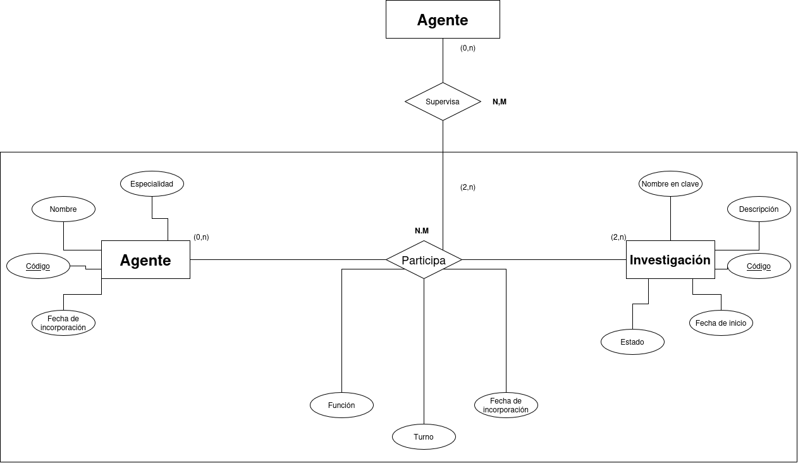
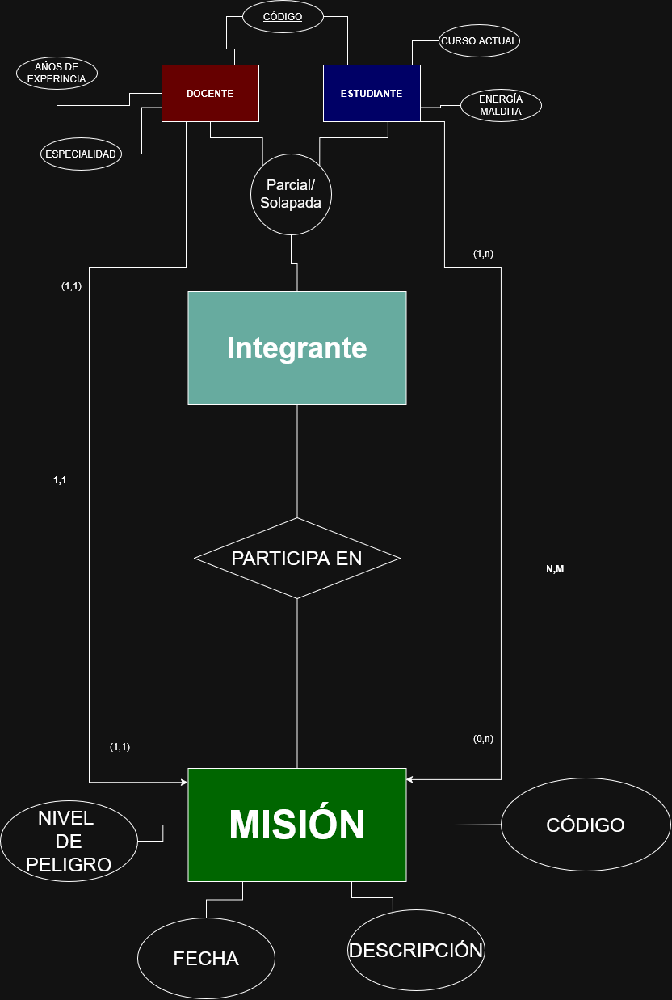

# ACTIVIDAD 2 MODELOS E/R EXTENDIDOS

## Ejercicio 1. Star Wars: Flota de la Alianza Rebelde

  

### ENTIDADES:

 

**VEHÍCULO** TOTAL DISJUNTA

**BASE**

**MISIÓN**

   

### RELACIONES:

 

Un **VEHÍCULO** puede estar asignado o no a una **MISIÓN**

Una **BASE** puede tener **VEHÍCULOS** o no tener ninguno

Una **MISIÓN** debe contar con uno o más **VEHÍCULOS**

Para cada **VEHÍCULO** asignado se guarda la función que desempeña en la **MISIÓN**

   

### ATRIBUTOS
 

De cada **VEHÍCULO** se guarda un  *<ins>CÓDIGO<ins>*, Un *AÑO* de fabricación, un *NOMBRE* y un *ESTADO*

De cada **VEHÍCULO** con los subtipos *TERRESTRE* y *DESLIZADORES* se registran los atributos: *NÚMERO DE OCUPANTES* y *VELOCIDAD MÁXIMA*

De cada **VEHÍCULO** con los subtipos *TERRESTRE* y *CAMINANTE* se registran los atributos: *NÚMERO DE PATAS* y *CAPACIDAD DE TRANSPORTE*

De cada **VEHÍCULO** con el subtipo *AÉREO* se registran los atributos: *ALTITUD MÁXIMA* y *TIPO DE PROPULSIÓN*

La entidad **BASE** tiene los atributos *PLANETA*, *CÓDIGO* y *NOMBRE*

La entidad **MISIÓN** tiene los atributos *NOMBRE*, *CÓDIGO* Y *OBJETIVO*

   

### SUBTIPOS
 

**VEHÍCULOS** se divide en los subtipos:

*TERRESTRE* TOTSL DISJUNTA

*AÉREO*

Del mismo modo *TERRESTRE* se divide en los subtipos:

*CAMINANTE*

y

*DESLIZADORES*

   

### CARDINALIDADES

Un **VEHÍCULO** puede estar asignado o no a una **MISIÓN** (0,1)

Una **BASE** puede tener **VEHÍCULOS** o no tener ninguno (0.n)

Una **MISIÓN** debe contar con uno o más **VEHÍCULOS** (1,n)

Un vehículo debe estar asignado a una base (1.1)

Comprueba durante la revisión si el modelo permite representar:

    un vehículo que no sea ni aéreo ni terrestre; no, porque es total y disjunta
    un vehículo terrestre que no sea deslizador ni caminante; no, porque es especial y disjunta
    un vehículo que sea a la vez deslizador y caminante; no, no puede ser ambas
    una base sin vehículos; sí, una base puede no tener vehículos
    una misión sin vehículos asignados; no, son claros con que no es posible
    un vehículo asignado simultáneamente a dos misiones activas. no, el máximo es una misión

## Ejercicio 2. Stranger Things: Investigaciones en Hawkins

  

### ENTIDADES:

 

**AGENTE**

**INVESTIGACIÓN**

   

### RELACIONES Y CARDINALIDADES:

> El sistema registra agentes, investigaciones y la asignación de cada agente a una investigación.

 

Un **AGENTE** puede no estar asignado a ninguna **INVESTIGACIÓN** o participar en varias (0,n)

Toda **INVESTIGACIÓN** debe tener al menos dos **AGENTES**  (2,n)

El grupo registra qué **AGENTES** participan en cada **INVESTIGACIÓN**

De cada **PARTICIPACIÓN** concreta se guarda la función del **AGENTE** en esa **INVESTIGACIÓN**

Cada **PARTICIPACIÓN** concreta debe estar supervisada por un **AGENTE** (1,1)

Un **AGENTE** puede supervisar ninguna, una o muchas **PARTICIPACIONES** (0,n)

Un **AGENTE** no puede supervisar su propia participación en esa misma **INVESTIGACIÓN**

   

### ATRIBUTOS
 

De cada **AGENTE** se guarda un  *<ins>CÓDIGO ÚNICO<ins>*, Una *ESPECIALIDAD*, un *NOMBRE* y un *FECHA DE INCORPORACIÓN* 

De cada **INVESTIGACIÓN** se registra un *<ins>CÓDIGO ÚNICO<ins>*, *NOMBRE EN CLAVE*, *DESCRIPCIÓN*, *FECHA DE INICIO*, *ESTADO*

De cada **PARTICIPACIÓN** concreta se guarda la *FUNCIÓN DEL AGENTE*, *EL TURNO ASIGNADO*, *FECHA DE INCORPORACIÓN AL EQUIPO*

   

Comprueba durante la revisión si el modelo permite representar:

    un agente que todavía no participa en investigaciones; Sí, es posible
    una investigación con un solo agente; No, el mínimo es 2 
    una investigación con varios agentes; Sí, es posible
    una participación sin supervisor; No, no es posible
    un agente que supervisa varias participaciones; Sí, es posible
    un agente que intenta supervisar su propia participación. No, no está permitido

   

### Ejercicio 3. Jujutsu Kaisen: academia de hechicería

  

### ENTIDADES:

 

**INTEGRANTE**

**MISIÓN**

   

### RELACIONES Y CARDINALIDADES:

> La academia de hechicería necesita una base de datos para registrar a sus integrantes y organizar sus misiones. Las reglas de este ejercicio son ficticias y están adaptadas para la actividad
 

En cada **MISIÓN** participa al menos un **ESTUDIANTE** (1,n)

Un **ESTUDIANTE** puede participar en varias **MISIONES** o no haber participado en ninguna (0,n)

de la **PARTICIPACIÓN** de cada **ESTUDIANTE** en cada **MISIÓN** se registra el papel asignado y una evaluación, que puede estar pendiente.

Un **ESTUDIANTE** participa una sola vez en una misma **MISIÓN**

Solo pueden participar **ESTUDIANTES** cuyo nivel de *ENERGÍA MALDITA* sea igual o superior al nivel de peligro de la misión.

   

### ATRIBUTOS
 

De cada **ESTUDIANTE** se guarda un  *<ins>CÓDIGO ÚNICO<ins>* que mantendran como **DOCENTES** si llegan a ello , Un *CURSO ACTUAL* y un *NIVEL DE ENERGÍA MALDITA*.

De cada **DOCENTE** se registra un *<ins>CÓDIGO ÚNICO<ins>* que tienen desde que son **ESTUDIANTES**, *AÑOS DE EXPERIENCIA* Y *ESPECIALIDAD*.

De cada **MISIÓN** se guarda el *NIVEL DE PELIGRO*, <ins>*CÓDIGO*<ins>, *FECHA* y *DESCRIPCIÓN*

   

### SUBTIPOS

Los INTEGRANTES se dividen en los subtipos *DOCENTES* y *ESTUDIANTES*

Comprueba durante la revisión si el modelo permite representar:

    un integrante que todavía no es estudiante ni docente; sí, es posible
    una persona que desempeña ambos papeles; sí, es posible
    una misión sin docente responsable; no, no es posible
    una misión sin estudiantes; no, no es posible
    dos participaciones del mismo estudiante en la misma misión; no, no es posible
    una participación en una misión cuyo nivel de peligro supera la energía maldita del estudiante. no, no es posible

