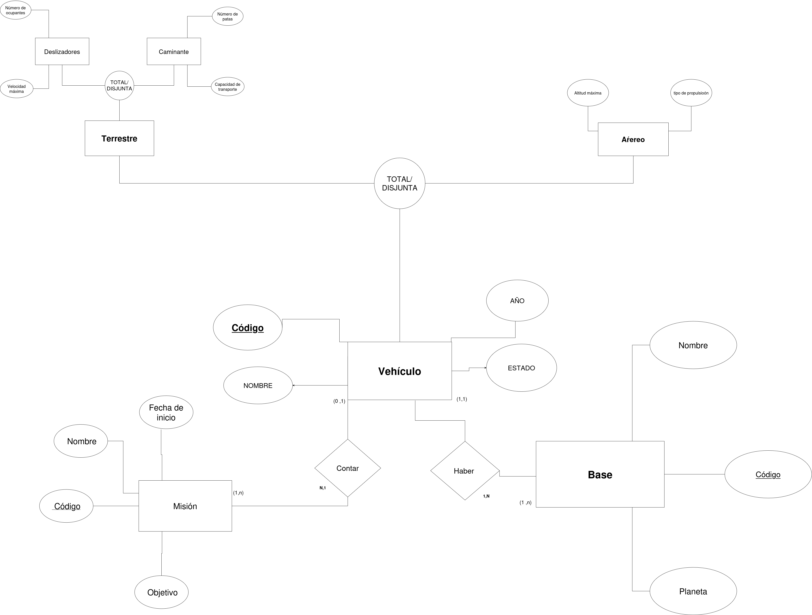

# ACTIVIDAD 2 MODELOS E/R EXTENDIDOS

## Ejercicio 1. Star Wars: Flota de la Alianza Rebelde

  

### ENTIDADES:

 

**VEHÍCULO** TOTAL DISJUNTA

**BASE**

**MISIÓN**

   

### RELACIONES:

 

Un **VEHÍCULO** puede estar asignado o no a una **MISIÓN**

Una **BASE** puede tener **VEHÍCULOS** o no tener ninguno

Una **MISIÓN** debe contar con uno o más **VEHÍCULOS**

Para cada **VEHÍCULO** asignado se guarda la función que desempeña en la **MISIÓN**

   

### ATRIBUTOS
 

De cada **VEHÍCULO** se guarda un  *<ins>CÓDIGO<ins>*, Un *AÑO* de fabricación, un *NOMBRE* y un *ESTADO* del **VEHÍCULO**

De cada **VEHÍCULO** con los subtipos *TERRESTRE* y *DESLIZADORES* se registran los atributos: *NÚMERO DE OCUPANTES* y *VELOCIDAD MÁXIMA*

De cada **VEHÍCULO** con los subtipos *TERRESTRE* y *CAMINANTE* se registran los atributos: *NÚMERO DE PATAS* y *CAPACIDAD DE TRANSPORTE*

De cada **VEHÍCULO** con el subtipo *AÉREO* se registran los atributos: *ALTITUD MÁXIMA* y *TIPO DE PROPULSIÓN*

La entidad **BASE** tiene los atributos *PLANETA*, *CÓDIGO* y *NOMBRE*

La entidad **MISIÓN** tiene los atributos *NOMBRE*, *CÓDIGO* Y *OBJETIVO*

   

### SUBTIPOS
 

**VEHÍCULOS** se divide en los subtipos:

*TERRESTRE*

*AÉREO*

Del mismo modo *TERRESTRE* se divide en los subtipos:

*CAMINANTE*

y

*DESLIZADORES*

   

### CARDINALIDADES

Un **VEHÍCULO** puede estar asignado o no a una **MISIÓN** (0,1)

Una **BASE** puede tener **VEHÍCULOS** o no tener ninguno (0.n)

Una **MISIÓN** debe contar con uno o más **VEHÍCULOS** (1,n)

Un vehículo debe estar asignado a una base (1.1)

